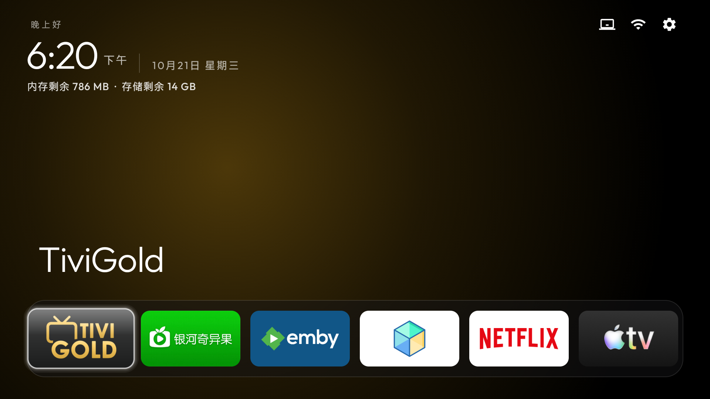
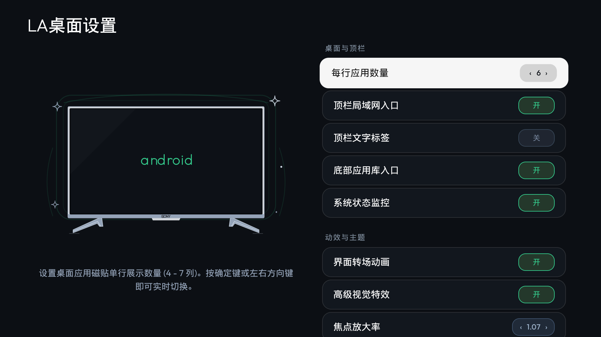

# LauncherAnywhere (LA桌面)

<p align="center">
  
</p>

<p align="center">
  <a href="https://github.com/aTenb/LauncherAnywhere/releases/latest"></a>
  <a href="https://github.com/aTenb/LauncherAnywhere"></a>
  <a href="LICENSE"></a>
  <a href="https://github.com/Gathin23/cleanyourtv"></a>
</p>

**LauncherAnywhere** 是一款专为 Android TV / Google TV 智能电视与电视盒子打造的轻量级、无广告、极简美观的电视桌面启动器。

> 📢 **开源致敬与版本声明**：  
> 本项目基于优秀开源项目 [CleanYourTV v2.4.0](https://github.com/Gathin23/cleanyourtv) 深度定制、功能扩展与重构。在此对原作者及社区贡献者致以崇高的敬意！

---

## 📸 界面预览 (Screenshots)

| 首页界面 (Home Screen) | 桌面设置 (Settings Screen) |
| :---: | :---: |
|  |  |
| *极简 Outfit 艺术时钟、顶部快捷药丸、自适应磨砂玻璃 Dock 栏* | *微光电视剪影氛围卡片、焦点放大率精细调节、布局定制* |

---

## 🌟 核心差异与增强特性 (对比 CleanYourTV v2.4.0)

相比原版 CleanYourTV v2.4.0，**LauncherAnywhere v1.1.0** 带来了诸多深度定制与实用功能的全面升级：

### 1. 🎯 Dock 焦点放大率自定义 (Focus Scale 1.00 ~ 1.20 精细调节)
- **全新定制**：打破原版固定硬编码的缩放倍率，在「桌面设置 - 主题」中新增焦点放大率调节项；
- **微调步进**：支持从 **1.00 至 1.20** 范围精细调节，步进精度高达 **0.01**；交互手感与每行应用数无缝融合，满足各类屏幕尺寸与视距需求。

### 2. 🌐 内置局域网 (SMB) 文件与应用管理器
- **免 U 盘装应用**：内置专为电视遥控器深度优化的 `SmbActivity`，轻松访问局域网 NAS、电脑或路由器共享文件夹；
- **智能 APK 管理**：一键浏览共享目录下的 APK 安装包，下载时实时展示高精度进度条，并可直接在电视上调起安装；
- **快捷导航**：顶部状态栏增加可选 SMB 快捷药丸图标，一键直达局域网空间。

### 3. 📐 Dock 栏与磁贴多列全自适应体系 (4 - 7 列适配)
- **智能布局算法**：磁贴宽度、高度、边距、圆角与焦点放大比例实时联动；
- **自适应字号**：应用名称根据列数（10sp ~ 14sp）及焦点比例进行平滑阶梯缩放，告别文字溢出与重叠；
- **底栏透明度定制**：支持 Dock 底栏透明度与主题底色个性化设置。

### 4. 🧭 顶部状态栏视觉统一与对齐
- **顶栏对齐重构**：顶部药丸按键与左侧问候语、时钟基准线严格对齐；
- **文字平滑切换**：图标文字标签开启/关闭时均保持纯净居中对齐，消除视觉割裂感。

### 5. ✨ 现代 TVOS 极简美学与氛围动效
- **微光轮廓设计**：全新绘制的电视机（如 Sony TV）矢量剪影配合星光粒子光晕，设置页面极具未来科技感；
- **全新视觉控件**：升级高品质磨砂玻璃胶囊（`settings_badge_*`、`tvos_*`），层级分明，视觉轻量优雅。

### 6. 🇨🇳 100% 完整简体中文本地化 (zh-rCN)
- 覆盖全部配置选项、SMB 管理器交互、快捷弹窗提示及状态通知，带来自然流畅的母语级体验。

### 7. 🚀 全新架构与独立包名
- 正式独立包名：`la.launcheranywhere`
- 内部版本号：`1.1.0` (VersionCode: `6`)
- 轻量无冗余，启动迅速，内存占用极低。

---

## 📥 获取与编译 (Build & Install)

### 方式一：获取源码发布包 (Releases)
前往 [GitHub Releases](https://github.com/aTenb/LauncherAnywhere/releases/latest) 下载最新发布的 `LauncherAnywhere-v1.1.0-source.zip` 源码压缩包。

### 方式二：克隆源码编译
本项目使用标准 Android Gradle 构建：
```bash
git clone https://github.com/aTenb/LauncherAnywhere.git
cd LauncherAnywhere/launcher
./gradlew assembleRelease
```
编译生成的 APK 位于：`launcher/app/build/outputs/apk/release/app-release.apk`。

安装到电视：
```bash
adb connect <你的电视IP>:5555
adb install -r app/build/outputs/apk/release/app-release.apk
```

---

## 🛠️ 技术规格

- **运行环境**：Android 5.0 (API 21) 及以上 Android TV / Google TV 设备
- **开发工具**：JDK 17 + Android SDK
- **上游基线**：CleanYourTV v2.4.0

---

## 📄 开源许可证 (License)

本项目遵循 [MIT License](LICENSE)。
欢迎提交 Issue 和 PR 交流改进！
